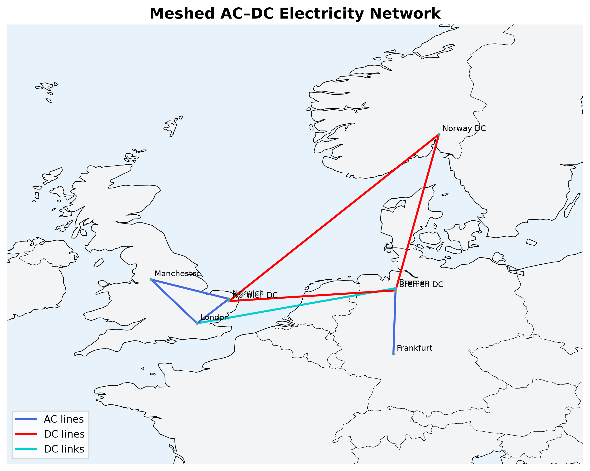

# PyPSA AC–DC Network Optimization

This project examines electricity generation, wind curtailment, and generation investment decisions in a simplified European electricity network using [PyPSA](https://pypsa.org/). The analysis explores how renewable availability, transmission interconnections, and generation costs influence electricity dispatch and investment decisions.

## Network Overview



*Geographical representation of the simplified meshed AC–DC network, showing buses, AC transmission lines, DC lines, and converter links.*

## Tasks

1. **Network Optimization and Generator Dispatch:** Optimize the meshed AC–DC network and examine generator investment and dispatch decisions, including the role of wind availability and generation costs.

2. **Electricity Generation, Wind Curtailment, and Storage:** Compare electricity generation with demand, identify wind curtailment, and discuss potential flexibility options, including battery storage, hydrogen production, district heating, and transmission expansion.

3. **Single-Node Optimization and Investment Sensitivity:** Convert the network into a single-node system and examine how changes in Norway Wind's capital cost affect investment in wind and gas generation capacity.

## Main Findings

- **Generator dispatch:** Wind supplies most electricity demand, while Frankfurt Gas operates at 05:00 and 09:00 to cover periods when available wind generation is insufficient.
- **Wind curtailment:** Curtailment is particularly high at 00:00 (3,064.56 MW) and 04:00 (2,112.02 MW), suggesting opportunities for additional system flexibility.
- **Investment sensitivity:** In the single-node model, additional Norway Wind capacity begins displacing Frankfurt Gas when its capital cost falls below approximately 114.67 in the model's cost units.

## Tools

Python, PyPSA, HiGHS, pandas, NumPy, Matplotlib, Cartopy, and Jupyter Notebook.

## Reproducing the Analysis

Clone the repository and install the dependencies:

```bash
git clone https://github.com/BigSam101/pypsa-ac-dc-optimization-analysis.git
cd pypsa-ac-dc-optimization-analysis
python -m pip install -r requirements.txt
```

Open `notebooks/meshed_ac_dc_network.ipynb` in Jupyter Notebook or VS Code and run all cells.

## References

- Creti, A., & Fontini, F. (2019). *Economics of electricity: Markets, competition, and rules*. Cambridge University Press.
- Kiehle, J., Lindroos, T. J., Louis, J.-N., & Pongrácz, E. (2026). Lost flexibility: Hydropower capabilities in large-scale, Pan-European energy system models. *Applied Energy, 423*, 128324. https://doi.org/10.1016/j.apenergy.2026.128324
- Wang, J., & Noel, W. (2024). *Energy market restructuring: Pembina Institute comments and recommendations*. Pembina Institute.
- [PyPSA Meshed AC–DC Network Example](https://docs.pypsa.org/latest/examples/ac-dc-lopf/)

## Note

The network is a simplified PyPSA illustration and does not represent the full European transmission system.